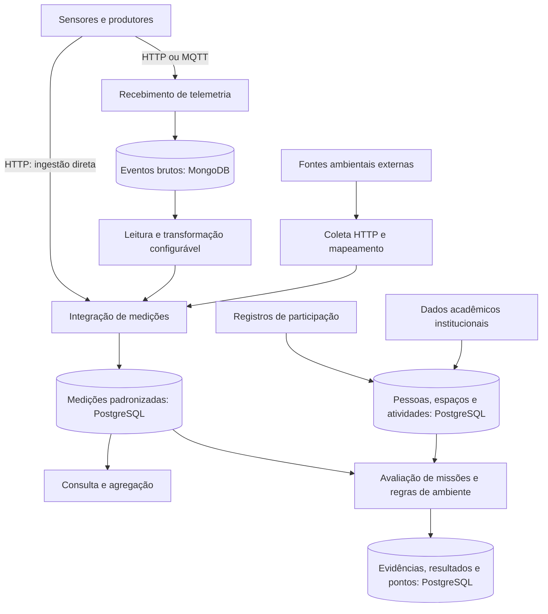

# Plano de revisão: acompanhar os dados do problema à avaliação

## Estado deste documento
Organização aplicada à reescrita integral dos capítulos em 12/11/2026. Backend de referência: commit b7192907eeb602a02cc3413f033bd2c4a7256397.
O mapa abaixo é conceitual e preliminar: não especifica cada transação nem substitui a validação dos fluxos ponta a ponta.
Relatórios de testes e benchmarks antigos continuam vinculados às versões originais.

## Argumento central
O projeto institucional prevê sensores em salas do Centro de Artes da UFPel e participação voluntária em ações de uso consciente da energia. O problema deste TCC é construir uma base de dados e serviços capaz de integrar fontes heterogêneas, relacionar observações ao contexto de uso dos espaços e fornecer informação rastreável para análise e gamificação. A intervenção comportamental e a comprovação de economia não se confundem com a avaliação dessa infraestrutura.

## Mapa preliminar dos dados
HTTP é Hypertext Transfer Protocol, protocolo de comunicação por requisição e resposta. As interfaces HTTP oferecem caminhos de ingestão direta e recebimento bruto. O recebimento MQTT, baseado em publicação e assinatura de mensagens, pertence ao serviço de telemetria.

A aplicação móvel que produzirá parte dos registros de participação é futura. A fonte humana representa os registros tratados pelo domínio, sem afirmar que o cliente móvel está implementado.
O processamento de missões e o de regras de ambiente são fluxos distintos, reunidos visualmente apenas no nível conceitual da avaliação.
Os eventos brutos têm retenção temporária. Ingestão direta e coleta externa não devem ser apresentadas como passando obrigatoriamente pelo MongoDB.
O leitor terá primeiro esse panorama; figuras posteriores detalharão cada caminho e as relações de armazenamento e consulta.
Para a versão final, dividir a figura em visão geral e detalhamentos, se necessário à legibilidade, e produzir a figura no formato LaTeX do TCC.

## Sequência narrativa do desenvolvimento

| Etapa | Pergunta que conduz a leitura | Desafios a explicar |
| --- | --- | --- |
| Origem e contexto | Que dados são necessários e por quê? | Sensores previstos, participação, espaços e dados acadêmicos; distinguir observação de inferência. |
| Recebimento e preservação | Como receber fontes diferentes sem perder sua identidade? | Formatos, substituição de dispositivos, duplicatas, origem, tempo e retenção do conteúdo recebido. |
| Integração | Como comparar observações produzidas em formatos diferentes? | Modelagem configurável, transformação de campos, tipos, identificação e versões de interpretação. |
| Representação e contexto | Como relacionar medições, pessoas e espaços? | Integridade relacional, fontes compartilhadas, validade temporal, ausência e desatualização de observações. |
| Interpretação e uso | Como transformar observações em informação útil? | Agregação, condições temporais, contexto acadêmico, regras de ambiente e missões; separar esses mecanismos. |
| Efeitos e rastreabilidade | Como explicar uma decisão e evitar recompensas repetidas? | Evidências, beneficiários, repetição de processamento e registro de pontos. |
| Avaliação | Que evidências demonstram cada propriedade? | Cenários e oráculos ligados aos desafios, limites dos testes e separação entre software e impacto comportamental. |

Para cada etapa: problema → decisão fundamentada → solução conceitual → evidência → limite. Detalhes de classes, rotas e configuração só entram quando necessários para demonstrar uma propriedade, ou em apêndice.

## Fundamentação: primeiro exemplo verificado
Grolinger et al. (2013), *Data management in cloud environments: NoSQL and NewSQL data stores*, Journal of Cloud Computing, DOI 10.1186/2192-113X-2-22, discute explicitamente *polyglot persistence* como utilização de diferentes armazenamentos para diferentes finalidades na mesma aplicação, atribuindo o termo a Sadalage e Fowler.
A entrada já existe no BibTeX como grolinger2013.
Fonte consultada: https://link.springer.com/article/10.1186/2192-113X-2-22

Aplicação ao TCC: distinguir a flexibilidade do conteúdo bruto das relações estruturadas do domínio e discutir também o custo de coordenar dois armazenamentos. O artigo fundamenta o conceito; não prova que a implementação é escalável ou superior a uma solução com banco único.
O estrato Qualis desse periódico ainda não foi verificado nesta rodada. Não atribuir classificação até consulta identificada.

## Evidências atuais consultadas no backend
- README.md: caminhos de recebimento bruto, ingestão direta, processamento, agregação e gamificação; contém trechos de estados de evolução diferentes, exigindo confronto com código.
- Proben-API/src/main/java/com/proben/api/service/shared/SharedContextCollector.java: coleta externa e chamada ao orquestrador de ingestão canônica.
- Proben-API/src/main/java/com/proben/api/service/sensors/SensorIngestOrchestrator.java: distingue ingestão direta, por perfil e originada na telemetria.
- Proben-API/src/main/java/com/proben/api/service/sensors/SensorIngestionService.java: persistência de observações no domínio.
- Proben-API/src/main/java/com/proben/api/service/environment/EnvironmentRuleWorker.java: avaliação recuperável de regras de ambiente e registro idempotente de pontos.
- As classes e testes adicionais devem ser inspecionados conforme cada seção for reescrita. A presença de testes não equivale a execução aprovada.

Versão: https://github.com/ravilon/PROCEL-Back-End/tree/b7192907eeb602a02cc3413f033bd2c4a7256397

## Uso do histórico de conversas
A busca recuperou trechos do PROCEL-DataHandler sobre modelagem inicial de salas e sensores, separação entre armazenamento bruto e relacional, perfis de integração, processamento temporal e contexto externo compartilhado.
O acesso é parcial. Algumas propostas mudaram ao longo do desenvolvimento; o histórico deve apoiar a reconstrução do raciocínio, e o código atual deve confirmar o que foi implementado.
Não usar conversas como referência científica. Não afirmar que todas as alternativas foram comparadas experimentalmente.

## Escopo aplicado à revisão
1. Reorganizar a introdução pelo cenário, problema de dados, lacuna e objetivos; retirar repetições e a abertura imediata por seção.
2. Revisar resumo e abstract para centrar proposta, método, artefato e contribuição; concentrar limites detalhados nos capítulos pertinentes.
3. Organizar a fundamentação em torno dos desafios da narrativa e criar uma matriz conceito–afirmação–artigo–evidência.
4. Reestruturar desenvolvimento conforme as etapas acima; inserir a figura e um exemplo acompanhado ao longo do percurso.
5. Atualizar referências da implementação sem reapresentar resultados antigos como testes da versão atual.
6. Revisar avaliação, conclusão e coerência terminológica; compilar e inspecionar o PDF.

## Resultado da aplicação
Os itens acima foram incorporados à revisão do texto. A figura principal foi produzida em TikZ e os detalhes de reprodução e capturas históricas foram organizados em apêndices. A versão atual foi inspecionada, sem nova execução de suas suítes. A matriz de fundamentação e o registro de validação complementam este plano. A figura Mermaid continua como mapa de trabalho; a figura do TCC representa o percurso com maior contexto.

## Atualização de pontuação
A referência atual foi atualizada para o commit b7192907eeb602a02cc3413f033bd2c4a7256397, que adota pontos em entidades, contratos e persistência. A migration V34 renomeia o registro de lançamentos e preserva seus dados. Relatórios antigos mantêm suas versões.
